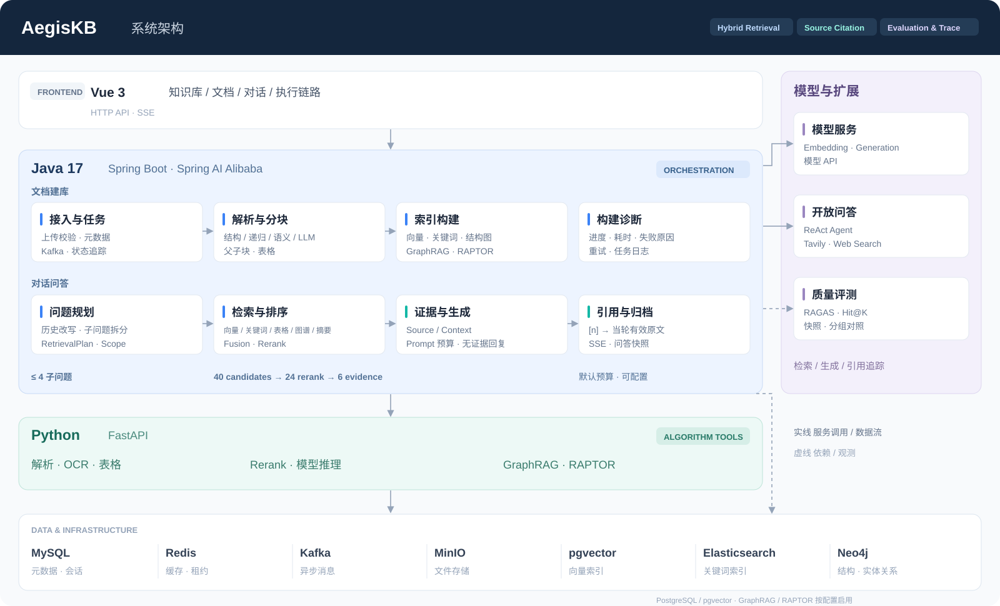

# AegisKB · 智能知识库

**让技术资料可检索，让回答有原文可查。**

面向技术文档与研究资料的检索增强生成系统

**4 种分块策略 · 5 类检索通道 · 当轮原文引用 · 评测与链路追踪**

[文档与索引](#01-文档分块与索引构建) · [检索与重排](#02-并行检索与融合重排) · [引用与证据](#03-答案引用与证据校验) · [评测与定位](#04-评测链路与问题定位)

---

AegisKB 支持文档建库、对话问答与原文溯源，面向查找技术细节、关联多份资料、核对回答依据等场景。项目围绕三个问题展开：**如何找全相关内容、如何保留必要上下文、如何让答案引用到有效原文。**

Java / Spring Boot 编排知识范围、检索计划、候选筛选、答案生成与引用绑定；Python / FastAPI 提供文档解析、OCR 与语义重排等算法能力。向量、关键词与图谱索引协同工作，检索和生成的中间结果可追踪、可评测。

## 系统架构

Java 统一编排文档建库与对话问答；Python 提供算法服务；检索索引、业务存储与外部模型各自承担明确职责。

## 01 文档分块与索引构建

**小片段便于命中，完整上下文帮助理解；跨文档关联补足单篇资料的边界。**

- **四种分块策略**：支持基于文档结构、递归、语义和大模型的切块方式，适配不同文档组织形式。
- **父子块结构**：以细粒度子块参与检索，结合父块与结构锚点补充上下文，缓解长文档片段脱离章节语境的问题。
- **多路索引**：构建 PostgreSQL / pgvector 向量索引、Elasticsearch 关键词索引与 Neo4j 图谱，分别服务语义匹配、精确词匹配和关联查询。
- **关联知识组织**：结合实体消歧组织图谱，以层级摘要概括长文档；图谱和摘要用于扩展检索线索，最终回答仍需落回有效原文。

实现入口：[DocumentStrategyTypeEnum.java](aegis-kb-common/aegis-kb-common-frame/src/main/java/org/aegiskb/enums/DocumentStrategyTypeEnum.java) · [GraphRagTypedChunkServiceImpl.java](aegis-kb-business/aegis-kb-business-chat/src/main/java/org/aegiskb/ai/manage/service/impl/GraphRagTypedChunkServiceImpl.java)

## 02 并行检索与融合重排

**先扩大相关信息的覆盖，再逐步收敛为有限的回答证据。**

结合会话历史改写问题，拆分为最多 **4 个子问题**。检索计划统一确定范围、过滤条件、通道和预算，各子问题按计划并行调度通道：

- **向量**：召回语义接近的原文片段。
- **关键词**：匹配术语、名称与精确表述。
- **表格**：查询结构化数据并返回单元格证据。
- **图谱**：利用实体、关系与社区信息发现关联内容。
- **层级摘要**：检索摘要节点，再向相关原文下钻。

融合阶段结合**加权 RRF、归一化原始分与元数据特征**，合并重复候选；随后通过语义重排调整相关性顺序，由 Java 执行最终证据选择。重排服务失败时可回退到融合排序。

> **默认窗口：40 → 24 → 6**
> 融合候选上限 → 重排窗口上限 → 最终证据预算。窗口可配置，实际数量受去重、证据资格和筛选结果影响；五类通道也按计划与索引可用性启用。

实现入口：[RetrievalPlanAssembler.java](aegis-kb-business/aegis-kb-business-chat/src/main/java/org/aegiskb/ai/chatagent/rag/service/RetrievalPlanAssembler.java) · [RagRetrievalEngine.java](aegis-kb-business/aegis-kb-business-chat/src/main/java/org/aegiskb/ai/chatagent/rag/service/RagRetrievalEngine.java) · [HybridFusionService.java](aegis-kb-business/aegis-kb-business-chat/src/main/java/org/aegiskb/ai/chatagent/rag/service/HybridFusionService.java) · [ChatRagProperties.java](aegis-kb-business/aegis-kb-business-chat/src/main/java/org/aegiskb/ai/chatagent/rag/config/ChatRagProperties.java)

## 03 答案引用与证据校验

**检索到的内容并不都具备引用资格，模型输出的编号也必须有对应原文。**

检索结果分为两类：**Source Evidence** 保存可引用原文，**Context Only** 提供摘要、导航等辅助上下文。两类内容分池处理，辅助上下文不会因为排序靠前而自动获得引用资格。

1. **生成前登记**：按照证据预算组装 Prompt，登记实际进入本轮 Prompt 的有效 Source 与引用编号。
2. **生成后绑定**：解析答案中的合法 `[n]` 编号，只绑定本轮清单内的原文；未知、越界或不具备资格的引用不会进入最终来源。
3. **归档保持一致**：引用绑定、最终结果与归档来源使用一致的证据身份，便于从答案回查原文。
4. **证据不足时收口**：没有足够有效原文时返回无证据回复，减少无依据回答。

这套机制约束的是**引用来源的合法性与一致性**；答案是否忠实于原文，继续由评测与人工核对检验。

实现入口：[FinalEvidenceSelectionPolicy.java](aegis-kb-business/aegis-kb-business-chat/src/main/java/org/aegiskb/ai/chatagent/rag/service/FinalEvidenceSelectionPolicy.java) · [ExplicitCitationBindingService.java](aegis-kb-business/aegis-kb-business-chat/src/main/java/org/aegiskb/ai/chatagent/rag/service/ExplicitCitationBindingService.java) · [RagChatExecutor.java](aegis-kb-business/aegis-kb-business-chat/src/main/java/org/aegiskb/ai/chatagent/rag/executor/RagChatExecutor.java)

## 04 评测链路与问题定位

**从“答案看起来合理”走向“能够指出问题发生在哪个阶段”。**

基于版本化数据快照与不可变评测产物，记录检索、生成和引用校验结果，支持实验复现与分组对照。结合 RAGAS 与 Hit@K，分别观察答案忠实度、上下文召回和目标证据命中情况。

> **项目评测记录 · 与简历口径一致**
> **48 条用例** ｜ **忠实度 0.81** ｜ **上下文召回率 0.85** ｜ **Hit@6 0.90**
>
> 以上为项目记录值，适用于对应样本与配置。当前分支 README 未附该批次的完整运行报告、模型配置和逐例评分，不能据此推断其他语料或配置下的效果。

排查时沿链路检查：**原文解析 → 通道召回 → 融合重排 → 最终证据 → Prompt 渲染 → 答案生成 → 引用绑定**，区分“没有召回”“排序靠后”“预算省略”和“生成遗漏”，再针对具体环节迭代。

评测中关注候选排序与长文档摘要的薄弱环节，为检索窗口、证据预算与摘要策略的调整提供依据。

## 技术组成

- **后端编排**：Java、Spring Boot、Spring AI Alibaba。
- **检索与存储**：PostgreSQL / pgvector、Elasticsearch、Neo4j。
- **算法服务**：Python、FastAPI，提供解析、OCR、重排等能力。
- **工程支撑**：MySQL、Redis、Kafka、MinIO；SSE 流式响应与执行链路观测。
- **质量评估**：RAGAS、Hit@K、问答快照与分组对照。

<strong>继续阅读实现</strong>

- [RetrievalPlanAssembler.java](aegis-kb-business/aegis-kb-business-chat/src/main/java/org/aegiskb/ai/chatagent/rag/service/RetrievalPlanAssembler.java)：知识范围、通道参数与窗口预算的统一装配。
- [HybridFusionService.java](aegis-kb-business/aegis-kb-business-chat/src/main/java/org/aegiskb/ai/chatagent/rag/service/HybridFusionService.java)：多通道候选融合与分项评分。
- [FinalEvidenceSelectionPolicy.java](aegis-kb-business/aegis-kb-business-chat/src/main/java/org/aegiskb/ai/chatagent/rag/service/FinalEvidenceSelectionPolicy.java)：最终证据资格、覆盖与预算选择。
- [ExplicitCitationBindingService.java](aegis-kb-business/aegis-kb-business-chat/src/main/java/org/aegiskb/ai/chatagent/rag/service/ExplicitCitationBindingService.java)：答案编号与本轮原文的显式绑定。
- [ChatRagProperties.java](aegis-kb-business/aegis-kb-business-chat/src/main/java/org/aegiskb/ai/chatagent/rag/config/ChatRagProperties.java)：子问题数量、检索窗口、超时和证据预算配置。

---

AegisKB · 文档建库 / 混合检索 / 原文溯源 / 评测迭代

