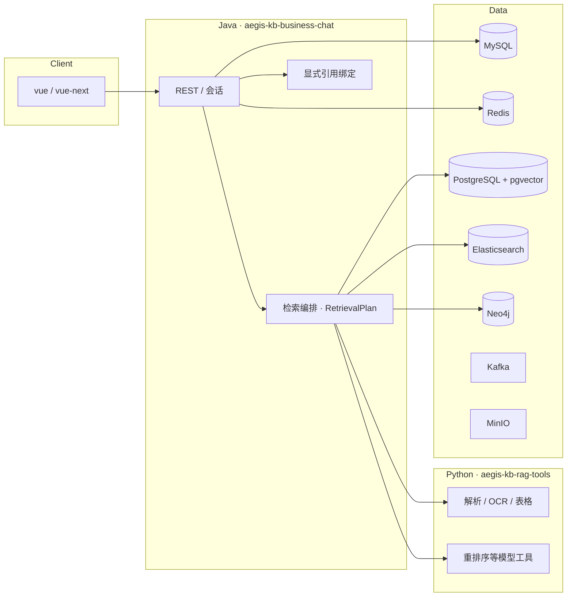

# AegisKB

<p align="center">
  <strong>企业知识库检索与问答</strong><br />
  多通道检索 · 显式可审计引用 · Java 业务编排 + Python 算法工具箱
</p>

<p align="center">
  <a href="https://github.com/xfu4739-commits/AegisKB"></a>
  <a href="https://github.com/xfu4739-commits/AegisKB"></a>
  <a href="https://github.com/xfu4739-commits/AegisKB"></a>
  <a href="https://github.com/xfu4739-commits/AegisKB"></a>
  <a href="https://github.com/xfu4739-commits/AegisKB"></a>
  <a href="http://www.apache.org/licenses/LICENSE-2.0"></a>
</p>

<p align="center">
  作者 <a href="https://github.com/xfu4739-commits">xfu-4739</a> · 北京交通大学<br />
  仓库：<a href="https://github.com/xfu4739-commits/AegisKB">github.com/xfu4739-commits/AegisKB</a>
</p>

---

## 目录

- [这是什么](#这是什么)
- [核心能力](#核心能力)
- [架构一览](#架构一览)
- [技术栈](#技术栈)
- [仓库结构](#仓库结构)
- [快速开始](#快速开始)
- [本地开发详解](#本地开发详解)
- [相关文档](#相关文档)

## 这是什么

**AegisKB** 面向企业场景的知识库 **检索增强生成（RAG）** 系统：从文档上传、解析与索引，到多通道检索、证据筛选与对话问答，主链路在 **Java（Spring Boot）** 中统一编排；**Python `aegis-kb-rag-tools`** 提供解析、OCR、重排序等算法能力，**不**决定知识范围、路由或最终引用绑定。

答案中的引用采用 **显式 `[n]` 标记**，只绑定当轮 Prompt 中渲染过的 **Source Evidence**，与 Context 扩展内容分池，便于审计与复核。

## 核心能力

| 领域 | 说明 |
| :--- | :--- |
| 知识库与文档 | 上传、解析路由、策略确认、索引与任务状态管理 |
| 检索 | 向量 / 关键词 / 结构导航等多通道；融合、重排后选出可引用证据 |
| 问答与引用 | Source Evidence 与 Context Only 分池；`[n]` 仅绑定已渲染 Source |
| 管理端与对话 | 生产 UI 在 `vue/`；实验性新版见 `vue-next/` |
| 示例与扩展 | `ai-example/` 收录 Spring AI / RAG 示例，**不**接入主产品链路 |

## 架构一览



**职责边界（简述）**

- **Java**：知识范围、会话、通道调度、融合/重排编排、最终证据与 Prompt、引用归档。
- **Python**：文档与模型侧工具；消费 Java 下发的计划，不回写业务决策。
- **前端**：经 Java API 代理访问；不在浏览器存放模型密钥。

## 技术栈

| 层级 | 选型 |
| :--- | :--- |
| 后端 | Java 17、Spring Boot 3.5、Spring AI、MyBatis-Plus、Redisson |
| 算法服务 | Python、`aegis-kb-rag-tools`（FastAPI 风格本地服务，默认 `18080`） |
| 前端（生产） | Vue 3、Vite、Tailwind、shadcn-vue（`vue/`） |
| 前端（新版） | Vue 3、Ant Design Vue / X Vue（`vue-next/`，独立端口 `5174`） |
| 中间件 | Docker Compose：MySQL、Redis、PostgreSQL、Elasticsearch（IK）、Neo4j、Kafka、MinIO |

## 仓库结构

```text
AegisKB/
├── aegis-kb-business/          # 业务模块（含 chat 主应用）
├── aegis-kb-common/            # 公共组件与 Web 基础
├── aegis-kb-rag-tools/         # Python 解析与模型工具
├── aegis-kb-*-framework/       # ID、Redis、Redisson 等基础框架
├── vue/                        # 管理端与对话（生产默认）
├── vue-next/                   # 新版 UI（与 vue/ 并行，不同端口）
├── ai-example/                 # Spring AI 学习与示例
├── docker-compose.yaml         # 本地中间件
├── scripts/                    # start-java / start-rag / start-vue 等
├── sql/                        # 库表初始化脚本
└── document/                   # 设计、验收与 RAG 改造文档
```

## 快速开始

适合第一次在本机跑通全流程；细节与验收见 [本地开发详解](#本地开发详解) 与 `document/RAG系统验收与运行/`。

| 步骤 | 操作 |
| :---: | :--- |
| 1 | 安装 **Docker Desktop**（建议 ≥ 8GB 内存）、**JDK 17**、**Maven**、**Node.js**、**Python 3.10+** |
| 2 | 仓库根目录：`docker compose up -d`（首次 ES 需按下文准备 IK 插件） |
| 3 | 复制 `.env.example` → `.env`，填写 `ALI_BAI_LIAN_API_KEY`（百炼 / DashScope） |
| 4 | 一次性：`aegis-kb-rag-tools` 创建 venv 并 `pip install -e .`；`vue/` 下 `npm install` |
| 5 | 根目录执行 `.\start.cmd`（或 `scripts\start-all.ps1`），浏览器打开 **http://localhost:5173/** |

**默认服务端口**

| 端口 | 服务 |
| :---: | :--- |
| `9083` | Java 后端 |
| `18080` | Python rag-tools |
| `5173` | Vue 开发服务器 |
| `5174` | vue-next（若单独启动） |

**健康检查**：`http://127.0.0.1:9083/actuator/health` 应为 `"status":"UP"`。  
**管理端默认账号**（可通过环境变量覆盖）：`application.yaml` 中 `app.admin-auth`，默认用户名 `admin`。

## 本地开发详解

### 前置：中间件与密钥

#### 1. Docker 中间件

`docker-compose.yaml` 按 `application.yaml` 中的本机端口启动 MySQL、Redis、PostgreSQL/pgvector、Elasticsearch（含 IK）、Neo4j、Kafka、MinIO。**Java、rag-tools、前端仍在宿主机进程运行。**

```bash
docker compose up -d
docker compose ps
```

首次构建 Elasticsearch 前，若 `docker/elasticsearch/plugins/` 下没有 IK 插件包，先下载（官网证书异常时可加 `-k`）：

```bash
curl -k -L -o docker/elasticsearch/plugins/elasticsearch-analysis-ik-8.5.2.zip \
  https://release.infinilabs.com/analysis-ik/stable/elasticsearch-analysis-ik-8.5.2.zip
```

镜像构建后会自动执行：

- `sql/表结构/Mysql/create_table_mysql.sql`
- `sql/表数据/Mysql/init_system_config.sql`
- `sql/表结构/PostgresSql/create_table_postgres_sql.sql`

若参数配置页中文乱码（旧 volume 在修复前初始化），在仓库根目录执行一次：

```powershell
Get-Content -Encoding UTF8 sql/表数据/Mysql/repair_system_config_charset.sql |
  docker exec -i aegis-kb-mysql mysql -uroot -proot --default-character-set=utf8mb4 aegis_kb
```

> 知识路由初始化脚本**不要**在空库上自动执行；待文档解析完成后再手工运行。

| 服务 | 宿主机地址 | 默认账号 |
| :--- | :--- | :--- |
| MySQL | `127.0.0.1:3307` / 库 `aegis_kb` | `root` / `root` |
| Redis | `127.0.0.1:6379` | 无密码 |
| PostgreSQL | `127.0.0.1:5432` / `aegis_kb_pgvector` | `postgres` / `postgres` |
| Elasticsearch | `http://127.0.0.1:9200` | `elastic` / `elastic` |
| Neo4j | `bolt://127.0.0.1:7687`（浏览器 `7474`） | `neo4j` / `12345678` |
| Kafka | `127.0.0.1:9092` | 无 |
| MinIO | `http://127.0.0.1:9000`（控制台 `9001`） | `minioadmin` / `minioadmin` |

Linux / WSL2 上 Elasticsearch 需要 `vm.max_map_count >= 262144`。

#### 2. 本机密钥（勿提交 Git）

在仓库根目录：

```text
.env.example  →  复制为  .env
```

至少配置 `ALI_BAI_LIAN_API_KEY`。可选：`TAVILY_API_KEY`、阿里云 Document Mind 等。启动脚本通过 `scripts/_load-local-config.ps1` 加载。

#### 3. Python rag-tools（首次）

```powershell
cd aegis-kb-rag-tools
python -m venv .venv
.\.venv\Scripts\pip install -e .
```

#### 4. 前端依赖（首次）

```powershell
cd vue
npm install
```

### 启动方式

以下方式**不会**再次执行 `docker compose`，请先完成中间件与 `.env`。

#### 方式 A：一键拉起（推荐）

根目录双击或运行 `start.cmd`，会打开 **三个独立 PowerShell 窗口**（Java / rag-tools / Vue）。编排窗口按 Enter 可关闭，**不会**结束那三个服务。

```bat
.\start.cmd
```

等价于 `powershell -File scripts\start-all.ps1`。Vue 会等待 Java `9083` health 为 `UP` 后再启动，避免 `/api` 代理 `ECONNREFUSED`。

#### 方式 B：分服务启动

```powershell
.\scripts\start-java.ps1
.\scripts\start-rag.ps1
.\scripts\start-vue.ps1
```

| 脚本 | 说明 |
| :--- | :--- |
| `start-java.ps1` | 无 jar 时先 `mvn package`；9083 已 UP 会提示跳过 |
| `start-rag.ps1` | 不自动创建 `.venv`，需先完成 Python 一次性安装 |
| `start-vue.ps1` | 轮询 Java 就绪后 `npm run dev` |

**提示**：Java 日志可能停在 MinIO / Kafka 附近而不再滚动，属正常；勿在 Java 控制台拖选文字（Windows QuickEdit 会暂停进程）。

### 与旧脚本的关系

已移除 `scripts/start-local.ps1`、`start-local.cmd`、`start-local.secrets.ps1.example`；密钥统一使用根目录 `.env`（见 `.env.example`）。

## 相关文档

| 文档 | 用途 |
| :--- | :--- |
| `document/RAG系统验收与运行/` | 真实环境启动、Python 安装与产品验收 |
| `document/RAG系统设计与重构/` | RAG 架构设计与分阶段改造 |
| `AGENTS.md` | 仓库协作与 RAG 改造约定（贡献者与 AI 辅助开发） |
| `DESIGN.md` | 前端 `vue` / `vue-next` 设计与重写边界 |

---

<p align="center">
  <sub>若 README 与本地分支不一致，请以 <code>main</code> 或文档目录中的最新手册为准。</sub>
</p>