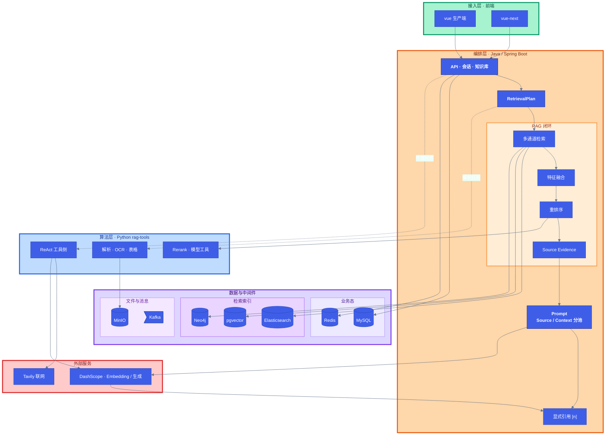
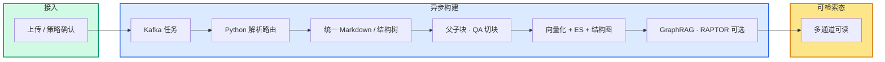
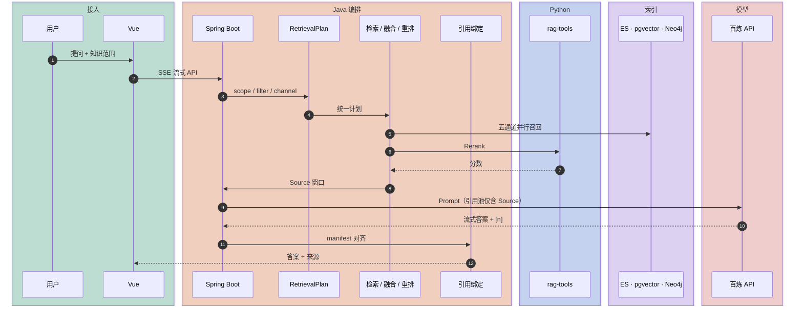

# AegisKB

  <strong>企业级 RAG 知识库与可溯源对话</strong> 
  Java 编排 · Python 算法工具箱 · 五通道混合检索

  
  
  
  
  
  

  作者 <a href="https://github.com/xfu4739-commits">xfu-4739</a> · 北京交通大学 
  仓库：<a href="https://github.com/xfu4739-commits/AegisKB">github.com/xfu4739-commits/AegisKB</a>

---

面向技术文档与企业资料场景的 **检索增强生成（RAG）** 系统：文档解析与多路索引、知识路由、混合检索、可溯源对话与开放式 Agent **统一由 Java 主链路编排**；Python `aegis-kb-rag-tools` 提供解析、重排等能力，不决定最终 scope 与引用。

> 环境安装、启动步骤与 182 篇源码讲解见个人配套教程，本页仅展示**架构**与**亮点**。

## 项目亮点

| | 亮点 | 说明 |
| :---: | :--- | :--- |
| 1 | **五通道并行检索** | 向量 · 关键词（ES+IK）· 表格 · **GraphRAG** · **RAPTOR** 同计划并发；**加权融合 + RRF** 收敛窗口，Python **Cross-Encoder Rerank**（可降级） |
| 2 | **Neo4j 知识路由** | 文档结构图 + **三级漏斗**自动缩小检索范围；子问题改写与并发；**RetrievalPlan** 一次解释 scope / filter / 通道 / 预算 |
| 3 | **可溯源引用** | Source Evidence 与 Context Only **分池**；答案仅 **`[n]` 显式绑定**当轮 Prompt 中的 Source，前后端不猜、不补引用 |
| 4 | **GraphRAG & RAPTOR** | 构建期可选实体图谱与摘要树；检索期社区报告、关系遍历与原文下钻，与经典向量/关键词同一融合窗口 |
| 5 | **双执行器** | 库内问题走 **RAG 执行器**（SSE 流式）；开放/时效问题分流 **ReAct + Tavily**，检查点与工具轨迹可观测 |
| 6 | **全链路可观测** | 通道级 / 候选级观测、同轮快照守恒、执行链路可视化；支持 **RAGAS**、Hit@K 等评测闭环（示例：Faithfulness **0.81**、Context Recall **0.85**、Hit@6 **0.90**） |
| 7 | **清晰工程边界** | **Java**：范围、检索编排、终证据、Prompt、引用权威；**Python**：解析/OCR/重排工具；**Vue**：经 API 代理，不持模型密钥 |

## 架构一览

### 分层总览

| 色块 | 含义 |
| :---: | :--- |
| 绿 | 前端 UI，只访问 Java API |
| 橙 | **业务权威**：计划 → 检索 → Prompt → 引用 |
| 蓝 | Python 工具箱（解析 / 重排 / Agent 工具） |
| 紫 | 业务库 + 多路检索索引 + 对象存储 |
| 红 | 大模型与外部搜索 |

### 文档入库与索引（构建链路）

### 单次问答（RAG 速讲）

---

  Spring Boot 3.5 · Spring AI · MyBatis-Plus · Kafka · Neo4j · pgvector · FastAPI rag-tools

