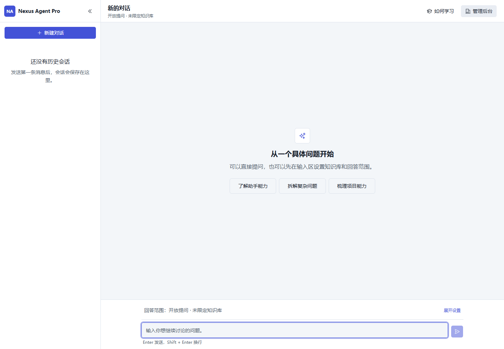
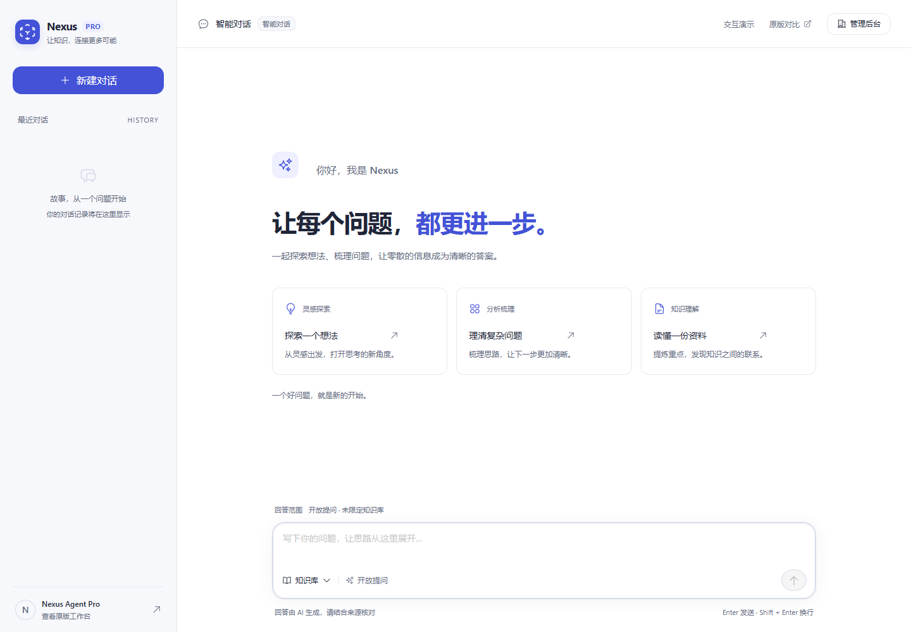
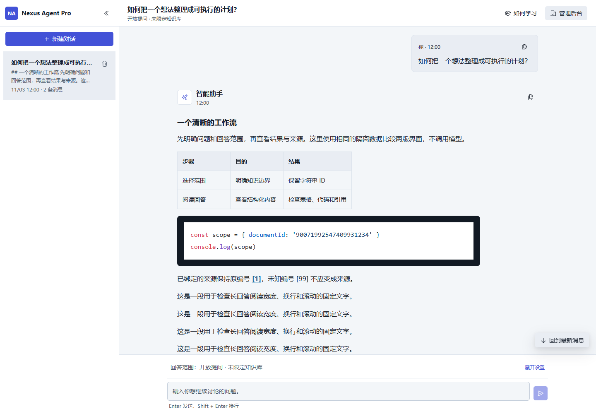
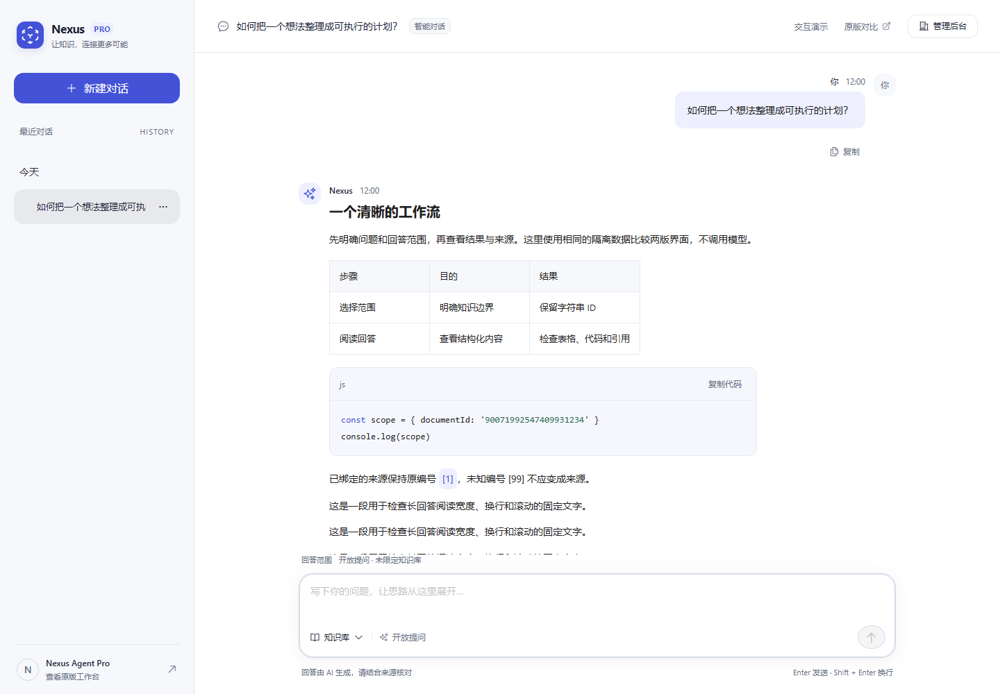
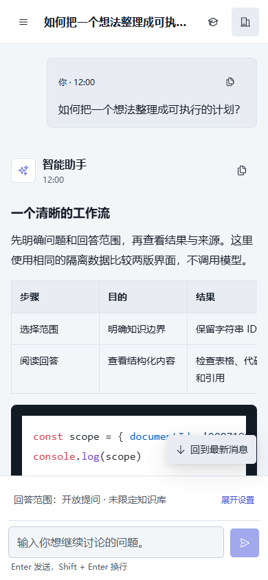
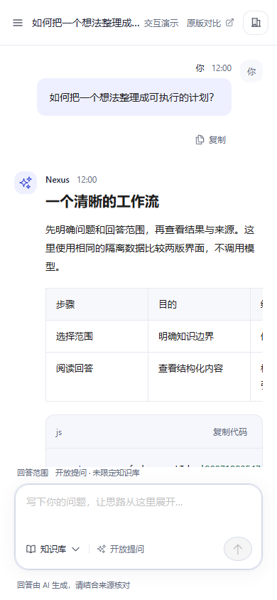
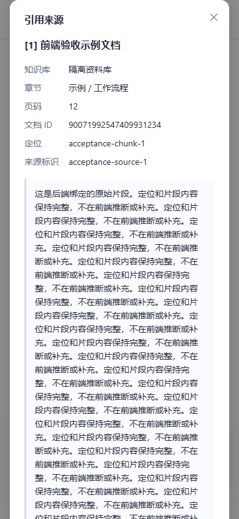
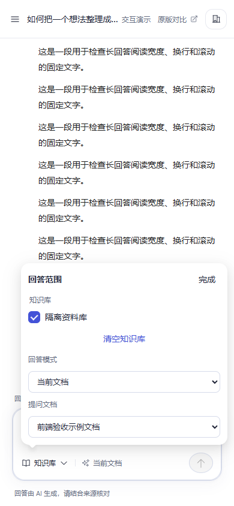

# M5 验收与新旧对比

当前状态：**M5 自动验收与对比证据交付完成；真实聊天体验和最终视觉结果等待用户确认。** 本文只记录独立聊天页重写，不涉及后台重写、默认入口切换或旧版删除。

## 访问与比较方式

- 新版：[http://localhost:5174/chat](http://localhost:5174/chat)
- 旧版：[http://localhost:5173/chat](http://localhost:5173/chat)
- 开发演示：[http://localhost:5174/preview/chat](http://localhost:5174/preview/chat)，刷新恢复，固定回复不调用模型。
- 实施和学习记录见 [前端重写计划](前端重写计划.md)。

`vue-next/e2e/fixtures/acceptance.js` 是两版共用的唯一对比资料：同一会话、问题、答案、时间、表格、代码、来源和错误。Playwright 在浏览器 context 拦截业务接口，新开旧版/后台标签页同样被隔离；未识别的业务请求直接报错，不穿透到真实后端。对比不发送问题、不删除会话，不用模型回答差异解释视觉差异。

对比尺寸为 390×844 和 1440×1000，分别保存欢迎、历史与失败场景；两版正文都固定到阅读区顶部。普通/减少动画模式各一组。另用 768、1024px 检查中间断点、移动抽屉和弹窗。

## 桌面截图

旧版欢迎页：

新版欢迎页：

旧版同一段历史回答：

新版同一段历史回答：

## 手机截图

旧版同一段历史回答：

新版同一段历史回答：

新版来源详情与范围设置：

其他证据位于 `evidence/M5/`：`legacy/next-error` 为同数据失败态，`source/scope` 为四种宽度的来源弹窗和范围面板，`legacy-admin-guard` 为原后台认证入口。`chrome-reduce-` 前缀为减少动画模式；M0/M1/M2/M4 历史证据不覆盖。

## 可以从截图核对的变化

- 导航：新版使用浅灰侧栏、分组会话、简短标题和操作菜单；旧版的 Markdown 摘要不会直接进入新版条目。移动端将会话放入抽屉。
- 阅读：新版白色阅读区、860px 正文容器，用户/助手分别对齐；头像、时间、复制、表格及代码使用同一套间距和语义 Token。
- 输入：新版整合多行草稿、知识范围、回答模式、文档和发送/停止；范围摘要持续显示。卡片和追问只填草稿。
- 来源：使用居中 Modal 展示后端片段与定位，长片段可在弹窗容器中滚动；保持来源 identity 和原编号，不补充未知来源。
- 品牌与主题：Ant Design Vue 提供基础控件，Ant Design X Vue 提供聊天结构，自定义图标沿用 Heroicons。原版入口和后台保留。

这些是界面事实；布局舒适度、信息密度和字体大小仍需用户实际查看确认，自动截图不能代替视觉评审。

## 功能覆盖清单

已建立自动验证：

- [x] 独立根跳转、旧版聊天/后台链接、新旧页面往返后的字体/背景/布局样式一致。
- [x] 原后台未登录访问受保护路由时仍跳转登录页；未提交真实账号密码。
- [x] 欢迎卡片键盘填入、会话分组/长标题、加载/空/失败状态、确认后删除与取消不删（隔离数据）。
- [x] 真实协议的列表/详情/分页、字符串 ID、历史范围恢复、选项失败、晚到详情和新建之间的竞态。
- [x] 三种回答模式、文档有效性、清空知识范围、冻结发送参数和原范围主动重试。
- [x] UTF-8 分片 SSE、中文输入法、Shift+Enter、Enter、重复发送和生成期间冲突操作锁定。
- [x] 服务端停止请求、停止失败重试、迟到片段、卸载取消和归档延迟保护（隔离数据）。
- [x] 部分回答保留、主动错误重试、追问填入、代码与消息复制、用户上滚暂停与恢复跟随。
- [x] Markdown 注入防护、未知/Context Only/无稳定 identity 引用失效、原编号保留、代码和链接中不生成引用按钮。
- [x] 来源 Modal、范围面板的 axe、Escape、焦点恢复和 390/768/1024/1440px 布局。
- [x] 四种宽度的页面无整体横向溢出、代码/表格独立滚动、移动导航焦点约束、跳到主内容和减少动画。
- [x] 独立源码依赖、主题 Token、正文对比度及无全局 Ant 样式覆盖。
- [x] 生产包不含开发演示状态与资料端点；生产访问 `/preview/chat` 回到 `/chat`，不请求演示接口。

待用户真实操作或确认：

- [ ] 新版完成一次开放提问及追问，检查实际流式回答和刷新后的归档。
- [ ] 在已有知识范围中提问，答案存在合法引用时核对片段、原编号与定位。
- [ ] 实际生成期间停止，确认已生成内容保留且服务端停止确认后可继续操作。
- [ ] 确认桌面/手机视觉、阅读密度和输入面板，确认本轮聊天页重写验收结束。

## 本轮验收发现与修正

1. 范围设置选中知识库后，“清空知识库”的框架默认链接蓝色对比度为 4.1:1。由实际 axe 红灯确认，主题新增 colorLink/hover/active 到已有 primary Token 的映射，未修改旧版或放宽 axe 规则。
2. 嵌套 Markdown 链接 `[[1]](https://example.org)` 会在链接内部生成引用按钮。先新增失败测试，再让链接内部的引用标签保持文字，避免嵌套交互目标；链接本身与正常引用按钮保留。
3. 旧生产包没有演示路由，但仍带入不可达的演示状态函数。生产包检查先红灯，再在状态选择处加入编译期 DEV 条件，使构建移除演示生成与资料请求代码。
4. 对比测试最初把 `/src/api/api.js` 误当业务请求拦截，已将匹配收窄为 URL 根路径。样式签名最初捕获了路由加载前的临时 main，改为等待两版实际聊天 main。截图改为即时滚动，避免旧版平滑滚动造成不同阅读位置。这些属于验收夹具修正，不修改旧产品。

## 运行结果

2026-11-03（Asia/Shanghai），在 `vue-next/` 执行：

- `npm run test:unit`：退出码 0，7 文件、29 项通过。
- `npm run check:design`：退出码 0，3 项通过。
- `npm run build`：退出码 0，3674 模块；入口 237.26kB、工作台 438.03kB、消息 137.25kB，未出现大块警告。
- `npm run test:e2e`：退出码 0，**66 项全部通过，5.2 分钟**；普通/减少动画各 33 项，包含原 M1—M4 的全部回归与本轮新增验收。
- `git diff --check`、`git diff --exit-code -- vue vue-claude`：退出码 0，旧工程未修改。
- 工作区保留未跟踪的 `DESIGN.md`、`doc/`、`vue-next/`；未自动提交、推送或部署。

`evidence/M5/` 共 60 张截图：同快照新旧对比 24 张，四种宽度来源/范围设置 16 张，欢迎/长内容回归 16 张，流式来源回归 2 张，原后台守卫 2 张。已直接查看桌面两版历史、手机两版历史及长来源截图，确认对比阅读位置、正文布局和手机换行。

生产预览临时进程已由测试关闭，用户原有 5173/5174 服务保持。浏览器 HTML 报告在 `vue-next/playwright-report/`，测试调试文件在 `vue-next/test-results/`，两者均被忽略，不作为长期截图证据提交。

## 已知限制与后续边界

- 本轮仅在 Windows Chrome 的桌面/模拟尺寸和两种动画偏好验证；未声称已在真实手机、Safari/Firefox 或真实读屏软件验收。
- axe、键盘和 Token 对比度检查不能证明全部可访问性体验；真实手机键盘弹出、触控及读屏仍可补充人工体验。
- 本轮未调用真实模型。只读会话水位与 M4 相同：conversationId `mvp4uk7aoxubl0dd`，updatedAt `2026-10-26 18:48:43`，四个旧 exchange ID 均未变化。因此真实生成、服务端停止和来源内容的正确性仍待用户验证。
- 原后台沿用旧版，只验证入口、未登录路由守卫和原源码未修改，不声称完成后台功能验收。5173/5174 的 localStorage 因端口不同而隔离，不自动跨源同步登录态。
- 第一版不含上传附件、语音、模型切换、会话重命名、点赞反馈或 Mermaid；这些是原计划明确排除的功能。
- 保留旧工程和默认入口；本轮没有发布、部署、自动提交、切换默认入口或删除旧版。

## 用户确认时的最小操作

1. 在新版 `/chat` 新建对话，主动发送一个问题；试用中文输入、换行和追问。
2. 在已有知识范围内提问，查看回答和可用来源；再用另一轮检查停止及刷新归档。
3. 对照上述桌面/手机截图和两版页面，反馈需要调整的位置，或明确确认本轮聊天页完成。用户完成后 AI 可以只读核验新增 exchange，不会修改数据制造通过。
