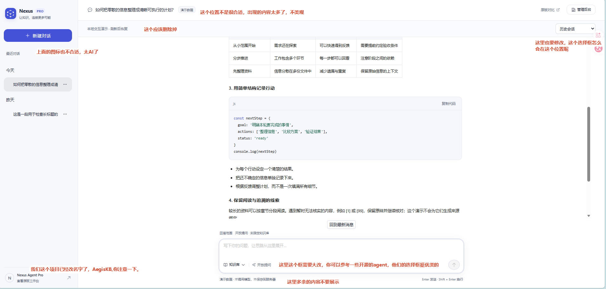
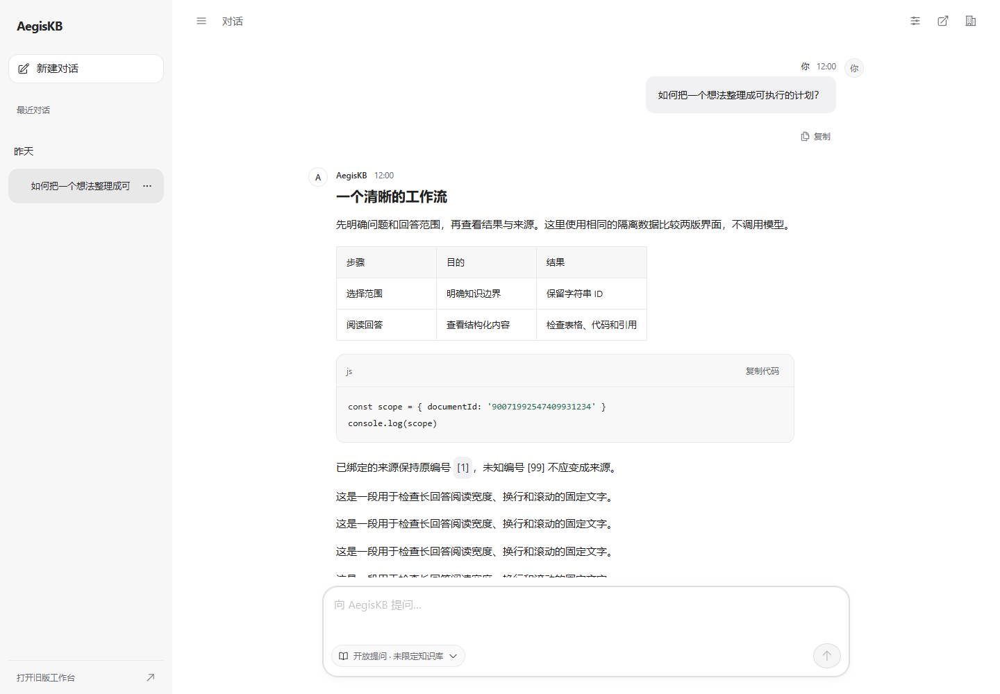
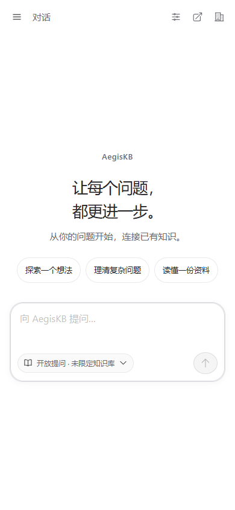
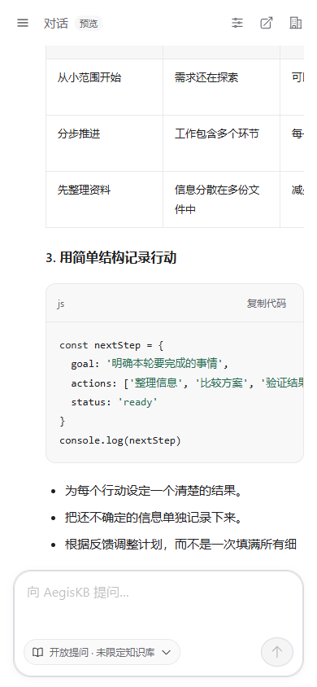

# AegisKB 聊天布局调整 · 2026-11-04

状态：**布局实现与本轮自动验证完成，等待用户查看新的视觉效果。**

## 本轮依据与边界

用户明确否定上一版布局，要求参考 DeepSeek、Cursor、ChatGPT，并在截图标注：顶部文字过多、演示横条应删除、场景选择位置不当、图标太有 AI 感、品牌已改名 AegisKB、输入面板需要重做、删除底部多余提示。

本轮只修改独立 `vue-next/` 的布局、文案、视觉 Token、图标与相关测试。保留原 `vue/`、后端协议、聊天/停止/引用逻辑、真实数据与默认入口。HEAD 仍为 `258f7a94c44c356f418506727fcf60e027036709`；开工工作区预存未跟踪 `DESIGN.md`、`doc/`、`vue-next/`。

已阅读根级设计约定，并按新意见更新其中的品牌、尺寸、顶部和输入面板约定。没有把旧 M5 的自动验收当成用户已经认可视觉，也不建立后端 Sxx 状态。

参考 [Cursor Agent 公开资料](https://cursor.com/docs/agent/overview)、[ChatGPT 公开界面资料](https://openai.com/index/introducing-canvas/)，采用收敛导航、减少常驻工具和聚焦内容的布局方向，不复制品牌或整页模板。DeepSeek 交互站本轮访问返回 403，未声称已完整检查其当前登录界面；主要设计依据仍是用户批注和本地截图验证。

## 批注对应改动

- 品牌：侧栏使用 AegisKB 文字字标；删除星芒/立方体标志、PRO 装饰和重复的底部品牌卡。浏览器标题、描述、favicon、欢迎页和助手名称一并更新。
- 侧栏：桌面收窄到 248px，可收起；新建对话改为中性描边按钮，减少强色面积。会话仍按时间分组，保留删除确认和长标题截断。
- 顶部：仅保留“对话”、导航控制与图标辅助入口，不再铺当前问题、会话长标题或状态标签。长会话标题继续留在侧栏。
- 演示：删除整行横条、右上常驻选择框和底部演示说明；开发预览保留小型“预览”标记，避免演示与真实数据混淆。场景选择收进“预览设置”弹层，生产构建不含该入口。
- 输入：760px 容器，较轻边框/阴影、多行输入和深色发送按钮。知识范围成为框内可点击的胶囊，显示真实模式/范围，展开后设置知识库、模式和文档。删除重复模式标签、框外“回答范围”和常驻快捷键/免责声明；快捷键仍通过 aria-describedby 提供给辅助技术。
- 阅读：正文最大宽度 800px，白色背景与更易阅读的正文尺寸；用户消息、助手回答、代码、表格、引用和复制保留。上滚后的回底部按钮改为阅读区内浮动圆形按钮，不再挤占输入框上方整行。
- 空状态：欢迎标题与输入框整体居中，三张大卡片改为轻量任务入口；有历史消息时输入框固定在阅读区底部。移动导航和来源 Modal 保留键盘焦点约束。

## 实现与学习记录

- `ChatWorkspace.vue`：组合布局、侧栏收起、空状态居中、预览设置弹层和浮动回底部。新增仅属于界面的 ref，不更改业务 composable。
- `ChatSidebar.vue`：字标、会话导航、低干扰新建入口与旧版链接；原会话 props/事件维持不变。
- `ChatComposer.vue` / `ChatInput.vue`：保留 Sender 和输入法保护，重组框内范围控件，移除框外冗余说明；不增加附件、模型切换或虚假功能。
- `ChatWelcome.vue` / `ChatMessages.vue`：轻量欢迎入口，统一 AegisKB 与字母头像，移除装饰性 AI 图标。
- `tokens.css`：使用中性色和深色主要操作，尺寸、圆角、字体和阴影仍集中定义；不向组件散落颜色。`index.html` / `public/favicon.svg` 更新浏览器品牌。
- `e2e/layout.spec.js`：本轮新增验收，先用旧布局复现品牌和整行工具栏红灯，再验证改后结构、侧栏收起/展开和预览设置。
- 学习点：布局状态和聊天状态分离；用父组件组合与 CSS 控制空态/历史态；辅助技术描述可以保留快捷键信息而不占视觉空间；删除页面说明不能删除当前知识范围的事实展示。

## 验证和截图

新增两项浏览器目标测试在实现前均失败；布局落地后，品牌/折叠、预览场景、范围设置、手机长消息和手机导航的 5 项定向测试通过。此前一次 npm 检查从仓库根目录运行，因该处没有 package.json 失败；已在正确的 `vue-next/` 重跑，不将其记录为产品故障或有效验收。

最终检查结果：

- 在 `vue-next/` 执行 `npm run test:unit`，退出码 0，7 文件、29 项通过；`npm run check:design` 退出码 0，3 项通过，包含对比度与 Token 边界。
- `npm run build` 退出码 0，3674 模块；入口 237.56kB、工作台 434.58kB、消息 137.19kB，无大块警告。
- 首轮完整 `npm run test:e2e` 覆盖普通/减少动画各 35 项：69 项通过，1 项在组合“新旧往返 + 后台守卫”用例中达到 30 秒超时，未出现对应产品断言失败。trace 显示旧页 networkidle 等待占用了后续后台检查时间。
- 将两个独立流程拆成独立用例，旧页改为等待真实输入框可用，保留全部样式签名、外链、登录页和受保护路由断言，没有提高超时。随后 `npm run test:e2e -- e2e/acceptance.spec.js --grep 'old app remains|admin link'` 退出码 0，两种动画偏好共 4 项通过，耗时 24.7 秒。此后仅修改测试组织，无生产代码变更，未重复运行其他已通过的浏览器场景，也不声称完成了一次“72/72 全绿”的整包运行。
- 全量与修复后定向结果覆盖本轮新增布局和此前会话、范围、输入法、流式停止、迟到事件、引用、复制、手机/平板、axe、键盘、减少动画和生产包隔离场景。
- `git diff --check`、`git diff --exit-code -- vue vue-claude` 均退出码 0；工作区仍为未跟踪 `DESIGN.md`、`doc/`、`vue-next/`。没有提交、推送、部署或后台/真实业务数据写入。

截图统一保存至 `evidence/layout-v2/`，共 63 张：延续 M5 的两版同数据/响应式/弹层等证据 60 张，预览设置相关新布局 2 张，用户批注原图 1 张。旧 M5 证据保留不覆盖。已实际查看桌面欢迎、桌面历史、手机欢迎与长消息，确认布局和文案变化。

入口：[真实聊天](http://localhost:5174/chat)、[本地演示](http://localhost:5174/preview/chat)。真实聊天仍由用户主动执行，AI 本轮只用隔离数据自动验证，不写真实 exchange。

## 待用户反馈

请重点查看整体留白、侧栏宽度、正文大小、输入框和范围胶囊。此处只交付本轮可运行布局，不自动开始后台重写或发布；真实聊天与最终视觉确认继续由用户完成。
