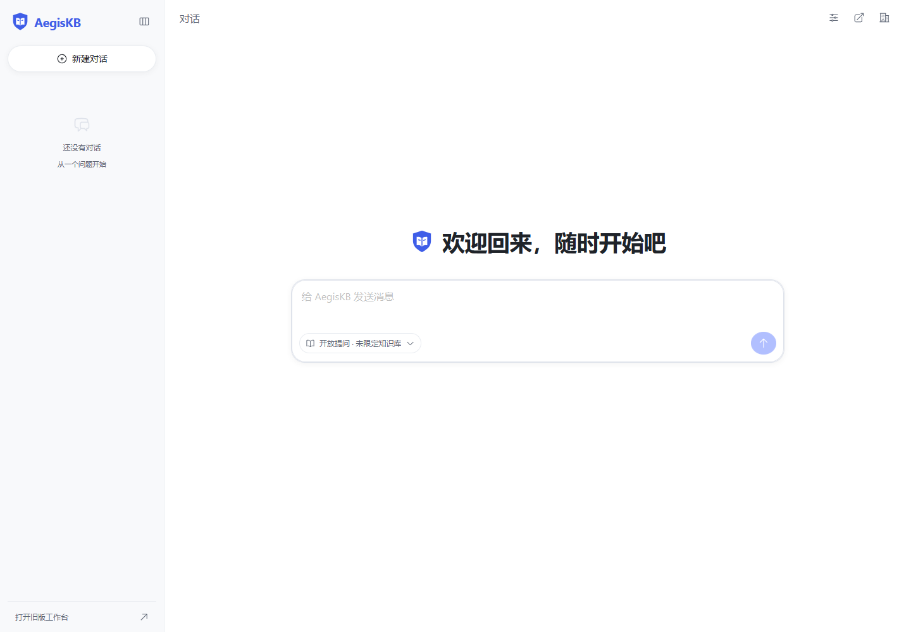
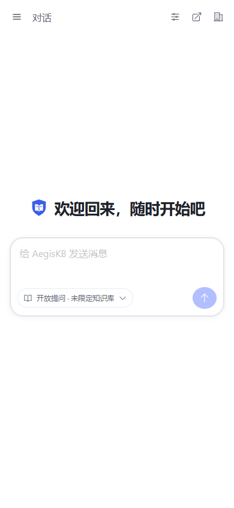
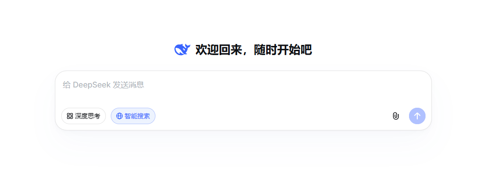

# 新建对话欢迎区简化 · 2026-11-04

用户指出新建对话时信息过多、字号与视觉焦点不明确，并提供单行欢迎语加输入框的参考。此次只调整欢迎区及相关验收，保留蓝白布局、图标、历史消息与输入功能。

## 实际调整

- 只保留盾牌书页图标与“欢迎回来，随时开始吧”。移除单独的 AegisKB 字标行、副标题和三个推荐入口。
- 欢迎语作为唯一 h1，桌面约 36px、字重 650，图标与文字同一行居中；手机使用约 26px 和 32px 图标，避免挤压输入框。
- 标题到输入框保持约 32—36px 间距，欢迎组与输入框一起居中。
- 欢迎组件不再发出预填问题事件，父页面移除失效监听；历史回答的追问功能保留。

修改集中在 `vue-next/src/features/chat/ChatWelcome.vue` 及其 workspace 调用。字号消费已有语义 Token，没有改全局 Token、页面整体尺寸或业务逻辑；用轻量原生标题结构避免额外组件包装造成信息层级分散。

## 验证

先将旧的“欢迎卡片填入草稿”用例改为本次目标：新建后只有一句欢迎语、移除多余内容、清空草稿并聚焦输入框。旧实现缺少新欢迎语，目标用例退出码 1；实现后通过。

- `npm run test:unit`：退出码 0，7 文件、29 项通过。
- `npm run check:design`：退出码 0，3 项通过，沿用九组对比度。
- `npm run build`：最终退出码 0，3675 模块；工作台约 427.26kB。清理失效事件监听后已重新执行门禁和构建。
- 受影响 Playwright 共 28 项全部通过，53.2 秒，普通/减少动画各 14 项。覆盖新建草稿/焦点、四种宽度的欢迎和导航 axe、删除后返回欢迎、历史初始化、页面往返、后台入口与生产默认入口。未重复无变化的流式/引用场景。
- 当前 HEAD `258f7a94c44c356f418506727fcf60e027036709`，工作区原有未跟踪 DESIGN.md、doc/、vue-next/。旧 `vue/` 与 `vue-claude/` 无差异，未自动提交、推送、部署或执行真实聊天。

## 截图

本轮保存至 `evidence/welcome-focus/`，此前蓝白完整布局截图保留。已直接查看桌面和手机结果。

查看：[聊天页](http://localhost:5174/chat)。点击“新建对话”即可看到本轮效果。
