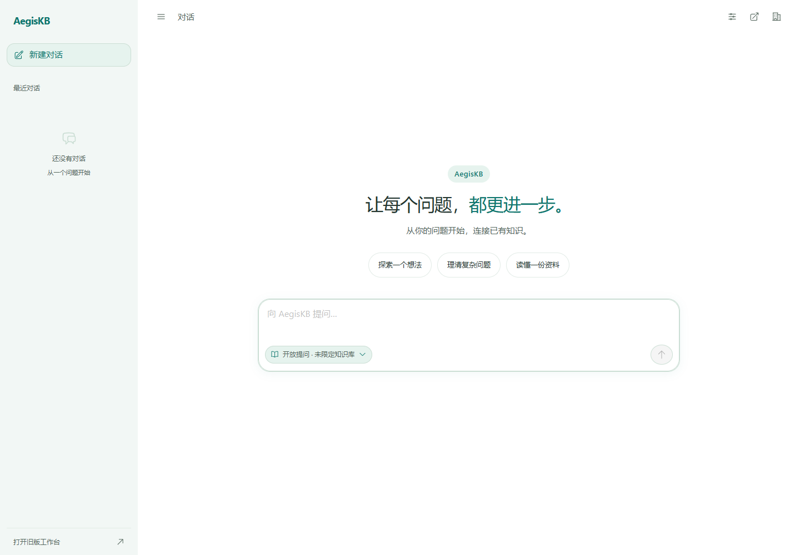
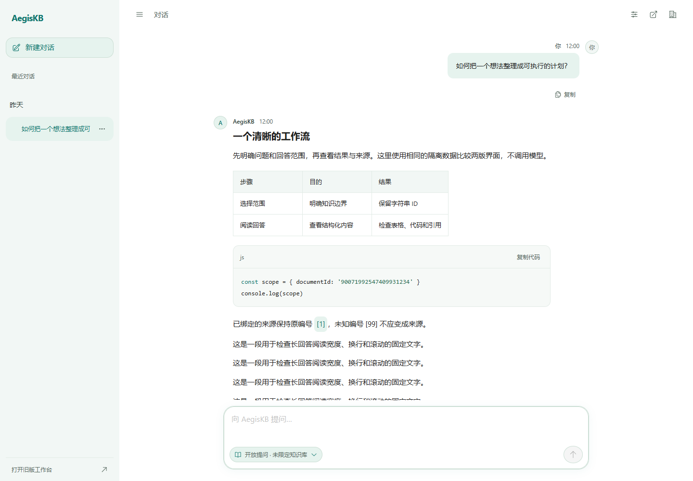
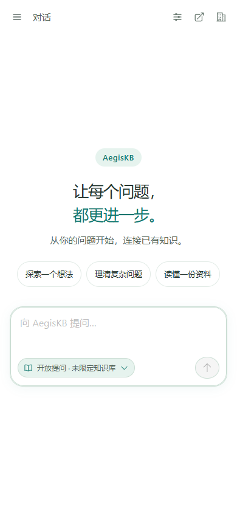

# AegisKB 色彩调整 · 2026-11-04

**历史试色记录：用户随后提供 DeepSeek 截图，明确选择蓝白布局并要求原创标志，本青绿方案已由蓝白版替代，不代表当前界面。**

用户认可第二版布局，希望页面有更明确的色彩。此次保留现有布局，选用青绿色作为统一品牌色，补足操作、选中与内容层级。

## 配色与使用位置

- 主色 `#0f766e`：品牌字标、欢迎标题重点、发送按钮、焦点、引用和选中会话文字。
- 深青绿 `#115e59`：悬停及按下状态。
- 浅薄荷 `#e6f3ee`：选中会话、用户消息、知识范围胶囊和新建入口的轻量底色。
- 侧栏 `#f2f7f5` 与白色阅读区：保持大面积安静，颜色集中在品牌与操作位置。
- 正文 `#23352f`、辅助文字 `#52655b`：保持足够对比度；代码区沿用低饱和色彩，不整块染成主色。

只修改 `vue-next/` 的视觉 Token、主题映射、对应组件样式及 favicon/theme-color；没有调整布局尺寸、聊天状态、接口、引用绑定或原工程。

## 实现边界与学习记录

- 所有 backing 色值集中在 `tokens.css`，Ant 的 primary、hover/active、link 和 primaryBg 映射到相同 Token，避免框架控件残留另一套强调色。
- Conversations 使用公开 classNames 接口挂自己的类，按已有 aria-current 为选中行应用浅绿底；不覆盖全局 `.ant-*` 类。
- 文字字标、标题、胶囊、头像与输入区只消费语义 Token，保留之前确认的结构和交互。
- 加入三组实际使用的对比度组合，现共九组。初始辅助文字在浅绿 accent 上未达到 4.5:1，先由门禁报告失败，再调深辅助文字；没有降低阈值。
- 品牌色解决识别，浅色解决选中/分组，深文字负责阅读；不靠增加装饰图标或额外说明制造视觉层次。

## 验证

本试色单测 29 项、设计门禁 3 项（九组对比度）、构建及完整浏览器回归 72 项通过；浏览器耗时 5.0 分钟。使用现有隔离数据验证，没有发送真实聊天。截图保存在 `evidence/theme-teal/`，保留 `layout-v2/` 的黑白版用于对比。用户在验证过程中给出新的蓝白参考，后续按新要求继续，而非将本方案作为最终视觉交付。

查看：[新版](http://localhost:5174/chat)、[本地演示](http://localhost:5174/preview/chat)。需要刷新已有页面以重新读取主题 Token。
