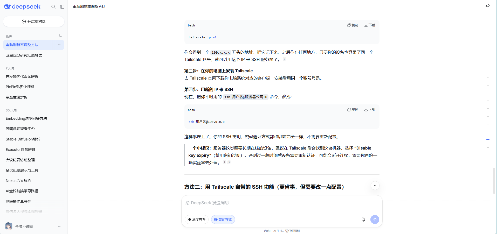
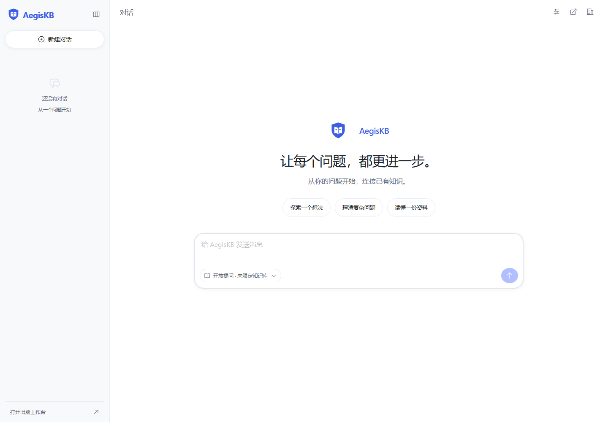
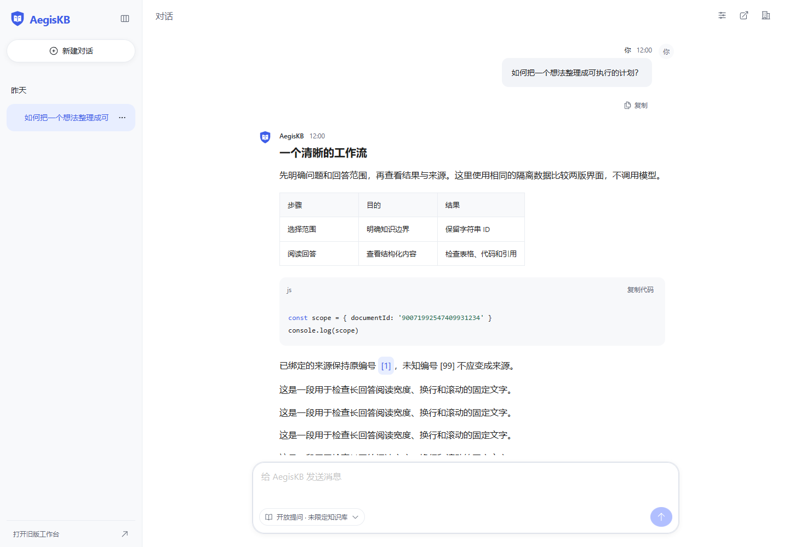
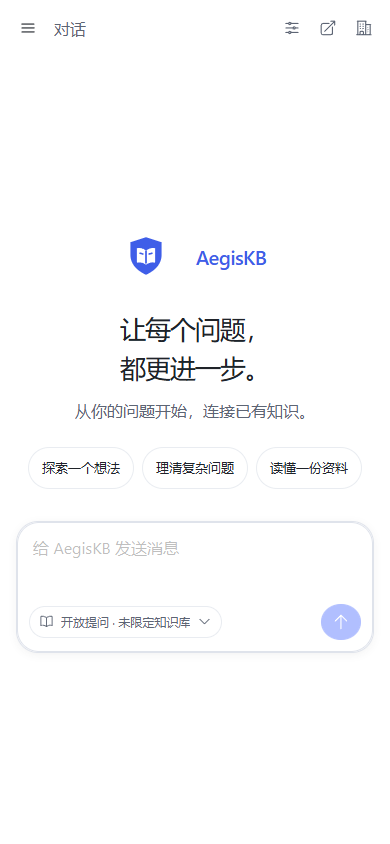

# AegisKB 蓝白布局与标志 · 2026-11-04

用户在配色调整过程中提供 DeepSeek 截图，明确要求采用其配色与布局方向，并为 AegisKB 创作图标。**蓝白版与原创标志已交付并完成本轮自动验证**；此前青绿方案只保留试色记录。

## 参考与实际设计

- 260px 浅灰侧栏，顶部为图标、蓝色 AegisKB 字标和折叠控制；白色圆角新建按钮，时间分组与淡蓝选中会话。
- 白色主阅读区，760px 正文，16px 正文字号；代码块使用浅灰背景，去掉重边框，保留复制和独立横向滚动。
- 780px 底部圆角输入框，克制阴影；范围控件使用白底胶囊，选择知识范围后用淡蓝强调；蓝色发送按钮与浅蓝禁用态。
- 外层阅读滚动条靠窗口右侧，内容自身保持居中；手机改为内边距和导航抽屉。欢迎页沿用已认可的居中结构。
- 保留 AegisKB 实际支持的知识库/模式/文档功能，没有照搬不受后端支持的思考、搜索、分享或上传入口。

主色为 `#3f5ee8`，与白底对比度约 5.28:1，与淡蓝底约 4.55:1；悬停为 `#304bd1`。采用蓝白方向并满足现有 4.5:1 门禁，不要求逐像素复制参考产品。

## 原创标志

源文件：`vue-next/public/aegis-mark.svg`。

- 外轮廓是盾牌，对应 Aegis 的守护含义。
- 中间用白色负形构成打开的书页，对应 KB 的知识内容。
- 中轴与两侧短线让小尺寸时仍能区分书页；透明底与单一蓝色方便复用。
- 图标用于侧栏、欢迎区、助手标识和 favicon，不增加一套图标依赖。其他功能图标继续使用 Heroicons。

SVG 为原创代码资产，可直接修改路径、颜色和尺寸；以单个源文件复用页面图片，favicon 使用同一图形。

## 实现与验证

- 修改前为现有布局测试补充品牌 SVG 接入断言，先确认旧版没有图标而红灯，再接入图片并验证资源确实加载。测试以图像可见且 naturalWidth 大于 0 为准，不将 Vite 的 SVG 内联形式误判为资源缺失。
- 颜色仍由 `tokens.css` 提供，Ant 主题沿用统一映射；九组实际文本/背景对比度通过。
- 新增标志不改变接口、聊天状态、知识范围或引用资格。此轮不修改原 `vue/`、后端和真实数据。
- 折叠动作由 `ChatSidebar` 通过 emit 交给 workspace 的 ref；收起后顶部提供展开按钮。布局状态继续与业务 composable 分开。
- `npm run test:unit` 退出码 0，7 文件、29 项通过；`npm run check:design` 退出码 0，3 项通过，包括九组实际对比度。
- 最终 `npm run build` 退出码 0，3675 模块，入口 237.68kB、工作台 435.39kB、消息 137.30kB，无大块警告。
- 蓝白版完整 `npm run test:e2e` 首轮 70/72 通过，两个品牌用例因错误要求 SVG 的 src 必须是固定路径而失败：Vite 将同一 SVG 正常内联为 data URL，图形已实际显示。修改为验证图片可见且 naturalWidth 大于 0，不改变产品代码或降低加载要求。
- 查看截图发现欢迎区的图标与字标被组件默认 flex 拉开，修正为 inline-flex 品牌组居中，并重建。随后对两种动画偏好的桌面/手机欢迎、品牌加载、侧栏收起/展开、手机键盘和 axe 执行 8 项定向回归，全部通过，22.2 秒。未重复其余已通过场景，不声称蓝白版执行过一次整包 72/72 全绿。
- 青绿试色的 72 项通过仅作为历史，不用于替代蓝白版验收。蓝白版的完整与定向证据覆盖现有会话、范围、输入、流式停止、引用、响应式、弹层、认证入口和生产包隔离。
- `git diff --check`、旧工程差异检查通过；工作区仍为未跟踪的 DESIGN.md、doc/、vue-next/。未自动提交、推送、部署或写真实业务数据。

## 页面截图与入口

入口：[聊天页](http://localhost:5174/chat)、[本地演示](http://localhost:5174/preview/chat)。刷新已有页面重新读取主题。

截图使用隔离数据，没有执行真实聊天或删除。此前黑白与青绿证据保留；整体视觉继续由用户查看反馈。

`evidence/blue-reference/` 共 65 张 PNG：原回归/对比的 60 张、新预览布局 2 张、独立品牌图 2 张和用户参考图 1 张。已直接查看桌面欢迎、桌面历史和品牌截图，确认标志显示、品牌组居中及蓝白视觉。
